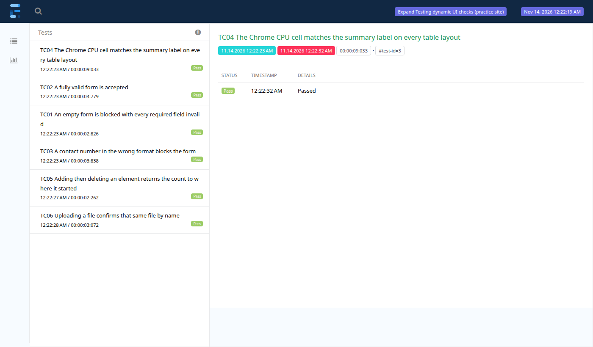

# Dynamic UI Reliability

A Selenium suite for the parts of a web UI that make tests flaky: client-side form validation, a table that shuffles its rows and columns on every load, elements added and removed at runtime, and a file upload. It runs against the [Expand Testing practice site](https://practice.expandtesting.com/).

This is an independent demo project. Nothing here reflects production or employment work.



## Stack

Java 21, Maven 3.9, Selenium 4.52, TestNG 7.12, ExtentReports 5.1, Log4j 2.26 and the Page Object Model. Last verified on Chrome 157 on Linux, on 14 November 2026.

## Run it

You need JDK 21, Maven and Chrome. Selenium Manager fetches the matching driver.

```bash
mvn clean test
```

The report is written to `target/test-evidence/dynamic-ui-report.html`. A failed test also adds a screenshot to the report and saves the page source as `target/test-evidence/<testName>.html`.

Useful overrides:

```bash
mvn clean test -Dheadless=false
mvn clean test -Dblock.ads=false
mvn clean test -Dlog.level=warn
```

## Test cases

| ID | Test | Input | Expected result |
|---|---|---|---|
| TC01 | Empty form | All required fields blank | All four fields fail the browser's validation and the form is not submitted |
| TC02 | Valid form | Asha Rao, 080-4567890, 15 Dec 2026, card | "Thank you for validating your ticket" |
| TC03 | Wrong format | Contact number without its dash | Only the contact number is invalid, its error is shown and the form is not submitted |
| TC04 | Shuffling table | Chrome row, CPU column, over 5 page loads | The CPU cell matches the "Chrome CPU" label on every load |
| TC05 | Add and remove | Add one element, then delete it | Count goes up by 1, the clicked element leaves the page and the count returns to its start |
| TC06 | File upload | A new temporary text file | "File Uploaded!" lists that file as `<timestamp>_<file name>` |

## How I know the tests can fail

| Condition | Result | What it shows |
|---|---|---|
| Default settings, repeated headless and visible-browser runs | 6 of 6 pass, about 15 to 25 seconds | The suite is stable in both modes |
| Ads allowed (`-Dblock.ads=false`) | 1 to 3 of 6 fail with `element click intercepted`, varying by run | The ad fix below is needed, and the failure is intermittent |
| Table read by fixed column position | TC04 fails on the second load, reading `8 Mbps` as the CPU value | Header mapping is what makes TC04 pass |
| Every expected value changed on purpose | 6 of 6 fail | No assertion passes regardless of behaviour |

## What I found

### An ad covered the buttons

The first run failed TC02, TC03 and TC06 with `element click intercepted`. The page source saved by the failure listener showed why: a Google anchor ad, 232 px high and fixed to the bottom of the viewport, sat over the Register and Upload buttons.

Ad fill varies from load to load, so on another day this would have looked like random flakiness. The suite now blocks the ad hosts at Chrome's DNS resolver (`--host-resolver-rules`), which keeps ads off the page without touching the site's own code. A JavaScript click would also have made the tests pass, but it clicks straight through an overlay that a real user cannot, so it hides exactly this kind of problem.

### An ad script changed the page text

With ads allowed, TC04 failed in my first two runs with errors like `expected [2.6%Compare Browsers] but found [2.6%]`. The ad script had inserted a link into the summary label. The CPU value was right and the test was too trusting, so the page object now extracts the percentage with a strict pattern and fails clearly if the label has none.

### Delete removes the wrong element

Each Delete button runs the same script, which removes the first button in the list rather than the one clicked. With three buttons, clicking the last one leaves it on the page and removes the first.

A test that only counts buttons would pass, because the count still drops from 3 to 2. `deleteLastAddedElement()` waits for the clicked element itself to go stale, so it catches this: with three buttons it times out. TC05 uses one button, as the brief specifies, so it passes. I left the three-button case out of the suite, because a test that fails on every run would only hide new failures.

## Testing decisions

**Columns are found by header text on every load.** The table moves CPU between columns on each reload, and in one run it sat at positions 3, 4, 1, 1 and 3 (counting from 0) across five loads. TC04 reloads five times because a single load can pass by luck: the fixed-position version passed its first load.

**Validity comes from the browser.** TC01 and TC03 read each field's `validationMessage`, the browser's own constraint check, not the red styling. Fields are located by `name`, because two of them share the id `validationCustom05`.

**Waits follow page state.** The suite waits for the form to gain its `was-validated` class, for the element count to change, and for a deleted element to go stale. There are no fixed sleeps.

**The upload file is created per run.** TC06 writes a new temporary file and deletes it afterwards. Its random name means the confirmation cannot be matching a file someone else uploaded to the shared site.

**The browser locale is pinned.** Chrome's date input takes typed digits in the locale's order, so the suite starts Chrome in `en-US` and logs the field's resulting value.

**Each test gets its own browser.** Tests run in parallel, with one `WebDriver` per thread. Any test can run alone, in any order.

## Selenium waits compared with Playwright

I use Playwright at work, where locators auto-wait for an element to be visible, stable and able to receive clicks, and assertions retry until they pass or time out. Selenium does neither by default, so each wait here is an explicit `WebDriverWait` condition.

The ad overlay would have failed under Playwright too. Its click retries while another element would receive the click, then times out, so auto-waiting would not have hidden the problem. Either tool needs the cause fixed.

## Logging

Each run writes its logs to its own folder, named after the time the run started:

```
logs/2026-11-14_00-22-19/
  dynamic-ui-reliability.log            every line from the run at DEBUG, tagged with its test name
  chromeCpuMatchesSummaryAcrossReloads.log  one file per test: its steps, the values it read and any stack trace
  ...
```

When a test fails, its own log is attached to that test in the Extent report, next to the screenshot. TC04's log records the column order on every load. `logs/` sits outside `target/`, so `mvn clean` keeps earlier runs. Delete old run folders by hand.

## Structure

```
src/main/java/com/dynamicui/reliability/
  config/      TestConfig: config.properties with -D overrides
  driver/      DriverManager: one Chrome per test thread, locale and ad blocking
  listeners/   ReportListener: Extent report, result logging and failure evidence
  logging/     RunLookup: gives each run's log folder its start time
  pages/       One class per page, with no shared base class
src/main/resources/
  config.properties  Target URL, headless mode, ad blocking and wait time
  log4j2.xml         Console, run log and per-test log routing into one folder per run
src/test/java/com/dynamicui/reliability/
  data/        TestData: fictional contact details and expected messages
  tests/       Form validation, dynamic table, add/remove and upload tests
testng.xml     Suite definition and parallel settings
```

## CI

`.github/workflows/reliability.yml` runs weekly and on demand, then uploads the report and logs as a build artifact. It does not run on every push, because the target is a shared public site and its outages should not look like broken commits.

## Known limitations

- It covers Chrome only.
- It depends on a public site that can change or go down without notice. A failure there needs checking against the site before it is treated as a defect.
- The ad blocking lists three ad domains. If the site adds another ad provider, the click intercepts can return.
- Surefire is pinned to 3.5.x because 3.6 no longer reads TestNG suite XML files.

## What I would add next

Firefox as a second browser, the drag-and-drop upload area, and the upload page's 500 KB size limit as a negative case.

## Credits

The application under test is the [Expand Testing practice site](https://practice.expandtesting.com/). The scope is based on the "Dynamic UI Reliability Lab" brief in Sreenidhi Rajakrishnan's Automation Project Build Guide, implemented here in Java and Selenium instead of Playwright.

## Licence

[MIT](LICENSE)
